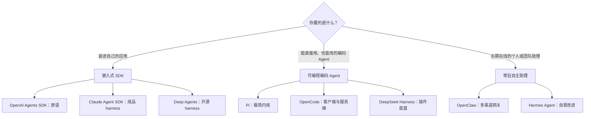

# AI Agent 框架选型

对 2026 年 11 月 8 个主流 Agent 框架 / harness 的横向比较：Claude Agent SDK、OpenAI Agents SDK、Deep Agents、Pi、OpenCode、OpenClaw、Hermes Agent、DeepSeek Harness。比较维度为设计理念、核心架构、功能特性、适用场景、上手难度、社区生态与维护活跃度，最后给出按场景的选型建议。

## 定义

“Agent 框架”在 2026 年已分化成三种东西，选型时先确定要的是哪一种：

1. **嵌入式 SDK**：作为库装进你自己的程序，由你的代码驱动 Agent 循环。[[entities/openai-agents-sdk|OpenAI Agents SDK]] 提供原语（Agent、Handoff、Guardrail），需要自己组装；[[entities/claude-agent-sdk|Claude Agent SDK]] 和 [[entities/deep-agents|Deep Agents]] 直接给一个已经搭好的 [[concepts/agent-harness|harness]]
2. **可编程的编码 Agent**：本身是能直接用的终端 / 桌面产品，同时开放 SDK、RPC 或插件接口供二次开发。[[entities/pi-agent|Pi]]（极简内核）、[[entities/opencode|OpenCode]]（功能完整的客户端 / 服务端）、[[entities/deepseek-harness|DeepSeek Harness]]（一切皆插件的底盘）
3. **常驻自主助理**：作为守护进程长期运行，通过 Telegram、Slack、WhatsApp 等聊天渠道交互，有定时任务和跨会话记忆。[[entities/openclaw|OpenClaw]]、[[entities/hermes-agent|Hermes Agent]]

## 关键特征

### 一、设计理念

- **Claude Agent SDK**：“把 Claude Code 当库用”。不重新实现 Agent，而是启动 [[entities/claude-code|Claude Code]] CLI 子进程，所以 Claude Code 有的能力都直接继承
- **OpenAI Agents SDK**：“少量原语 + Python / TS 原生写法”。只给 Agent、工具、Handoff、Guardrail、Session、追踪这几个积木，编排逻辑写在你的代码里；官方区分 SDK（跑在你的应用里）与 Agents API（OpenAI 托管的 harness）
- **Deep Agents**：“把好 Agent 的共性打包成默认值”。规划、虚拟文件系统、子 Agent、上下文管理、记忆、技能、人工审批都是开箱即用，底下是 [[entities/langgraph|LangGraph]] 运行时
- **Pi**：“最小内核 + 让用户自己改”。只有 read / write / edit / bash 四个工具、千 token 以内的系统提示；子 Agent、计划模式、权限弹窗、待办都不内置，交给 TypeScript 扩展。理由是前沿模型已被大量强化学习训练成懂编码 Agent 该怎么做
- **OpenCode**：“开源、模型无关、终端优先的 Claude Code 替代品”。功能完整，开箱即用
- **OpenClaw**：“住在你电脑上、通过你常用的聊天软件找到你的助理”。重心是渠道、常驻和本地数据，而不是编码
- **Hermes Agent**：“越用越强的 Agent”。完成复杂任务后自动生成技能、使用中改进技能，并维护跨会话的用户模型
- **DeepSeek Harness**：“一切皆插件”。模型适配器、工具注册表、会话日志乃至 Agent 循环本身都是 Cordis 插件，评测者称它“与其说是产品，不如说是底盘”

### 二、核心架构

| 框架 | 语言 / 运行时 | 架构要点 | 模型支持 | 协议 |
|---|---|---|---|---|
| Claude Agent SDK | Python、TypeScript；底层 Claude Code CLI（Bun） | SDK 进程 ↔ CLI 子进程，流式 JSON 通信 | 官方只支持 Claude（含 Bedrock、Vertex、Foundry）；换模型需 Anthropic 兼容端点，非官方支持 | Python 版 MIT，自带 CLI 专有；TS 版受 Anthropic 商业条款约束 |
| OpenAI Agents SDK | Python、TypeScript | 进程内 Runner 循环 + Handoff 图；可选沙箱工作区 | 默认 Responses API；可换任意 OpenAI 兼容端点或经 LiteLLM 接入百家 | MIT |
| Deep Agents | Python、TypeScript | LangChain Agent + 中间件，运行于 LangGraph 图运行时，checkpoint 持久化 | 任意 LangChain 支持的模型 | MIT |
| Pi | TypeScript（Node） | 分层包：pi-ai（统一 LLM API）→ pi-agent-core（Agent 循环）→ pi-tui → pi-coding-agent；另有 pi-durable | 30 多家提供方，可在会话中切换 | MIT |
| OpenCode | TypeScript | 客户端 / 服务端：`opencode` 同时启动 TUI 和 HTTP 服务器，TUI 只是客户端；服务端暴露 OpenAPI 3.1，SDK 由此生成 | 75+ 提供方（经 Models.dev），含本地模型 | MIT |
| OpenClaw | TypeScript（Node） | 本地 Gateway 作为控制面，管理会话、工具、事件和渠道连接；CLI、TUI、Control UI 都连 Gateway；模型与 harness 都是插件 | 托管与本地模型均可（Claude、Codex、本地模型等） | MIT |
| Hermes Agent | Python | 单进程 gateway 连接多个消息平台；Agent 循环 + 60 多个内置工具；会话存 SQLite + FTS5；六种终端后端 | Nous Portal、OpenRouter、OpenAI 或任意端点，20 多家 | MIT |
| DeepSeek Harness | TypeScript（Node，pnpm） | Cordis 插件框架，Agent 循环本身也是插件；按 profile 组合插件 | 默认 DeepSeek，也可配置 Anthropic、OpenAI、Bedrock、Azure 及任意 OpenAI 兼容端点 | MIT |

### 三、功能特性

| 能力 | Claude Agent SDK | OpenAI Agents SDK | Deep Agents | Pi | OpenCode | OpenClaw | Hermes Agent | DeepSeek Harness |
|---|---|---|---|---|---|---|---|---|
| 内置文件 / Shell 工具 | 有 | 沙箱 Agent 提供 | 虚拟文件系统，可接沙箱 | 四个核心工具 | 有 | 有 | 有 | 有 |
| 子 Agent | 有 | Handoff / Agent 作工具 | 有 | 不内置（扩展或 tmux） | 有（general、explore） | 有 | 有 | 插件（含委派给 Claude Code、Codex） |
| 规划 / 计划模式 | 有 | 自己实现 | 待办列表 | 不内置 | plan Agent | — | — | plan 模式 |
| MCP | 有（含进程内 MCP） | 有 | 有（适配器） | 1.0 前后内置（Codemode） | 有 | 有 | 有 | 作为 MCP 客户端 |
| 技能（SKILL.md） | 有 | — | 有 | 有 | 有 | 有（ClawHub） | 有，且自动生成和改进 | 插件与技能 |
| 权限 / 人工审批 | 权限模式 + Hooks | 人工审批、Guardrail | 人工审批中断 | 不内置，建议容器 | allow / ask / deny 规则 | DM 配对；沙箱默认关 | 命令审批、容器隔离 | 只读 / 工作区写 / 完全访问 |
| 会话持久化 | continue / resume / fork | Session（Redis、SQL 等） | LangGraph checkpoint | JSONL 会话树，可分叉 | 有，服务端保存 | 本地保存 | SQLite + 全文检索 | JSONL / SQLite 可换 |
| 聊天渠道 / 常驻 | — | — | Managed 版有 Slack | 另有 pi-chat | 移动端远程控制 | 20 多个渠道 | 十多个渠道 | 桌面版 |
| 定时任务 | — | — | Managed 版有 | — | — | 有 | 内置 cron | 插件 |
| 可观测性 | OpenTelemetry | 内置追踪，30 多种处理器 | LangSmith | pi-telemetry | — | — | 轨迹导出（训练用） | 开发者追踪视图 |
| 程序化工具调用 | — | 托管代码解释器 | 有（v0.6） | Codemode | — | — | — | PTC 模式 |

“—”表示资料中未见，不代表一定没有。

### 四、适用场景

- **Claude Agent SDK**：已经认定 Claude、想最快得到 Claude Code 级别编码 / 文件操作能力的产品（内部自动化、CI 修复机器人、代码审查、文档处理 Agent）
- **OpenAI Agents SDK**：需要多 Agent 分工、客服式 Handoff、语音 Agent、严格 Guardrail 的业务应用；配合 [[entities/chatkit|ChatKit]] 做前端
- **Deep Agents**：深度研究、长时多步任务，以及已在 LangChain / LangSmith 体系内、需要持久执行和可视化追踪的团队
- **Pi**：想要完全掌控 harness 的个人开发者与研究者；把 Agent 嵌进非 Node 程序（RPC）；作为自建产品的内核（OpenClaw 即一例）
- **OpenCode**：要一个开源、可换模型的日常编码 Agent；团队想用自托管或国产 / 开放权重模型；需要远程控制（服务端 + 多客户端）
- **OpenClaw**：个人助理、家庭或小团队的“常驻 Agent”，通过聊天软件派活、跑定时任务；对安全隔离要求不高或有能力自行加固的场景
- **Hermes Agent**：希望 Agent 长期积累技能和用户偏好的个人用户；跑在 VPS / 云沙箱上通过 Telegram 遥控；研究者生成工具调用训练轨迹
- **DeepSeek Harness**：想在 DeepSeek 模型上自建 Agent 产品、需要高度可替换组件的团队；用一个界面编排 Claude Code、Codex 等其他 Agent

### 五、上手难度

| 框架 | 起步方式 | 难度 | 说明 |
|---|---|---|---|
| OpenCode | 安装脚本或 npm，`/connect` 选模型 | 低 | 开箱即用，有桌面版 |
| OpenClaw | 安装脚本，`openclaw onboard --install-daemon` | 低到中 | 装起来容易，安全配置（暴露网关、沙箱）需要专业知识 |
| Hermes Agent | 安装脚本，`hermes model` 选模型 | 低到中 | 同上；可一键从 OpenClaw、Claude Code 导入 |
| Claude Agent SDK | pip / npm 安装，几行代码 | 低到中 | 能力强但行为由 CLI 决定，调试要理解 Claude Code 的配置体系 |
| OpenAI Agents SDK | pip / npm 安装 | 中 | API 小、文档好，但规划、文件、记忆要自己组装 |
| Deep Agents | pip / npm 安装 | 中 | 默认值好用，深入定制要懂 LangGraph 与中间件 |
| Pi | npm 安装 | 中到高 | 直接用不难，但要达到其他产品的功能需要自己写扩展 |
| DeepSeek Harness | `npx @deepseek-ai/dsh web` 或源码构建 | 中到高 | 开发者预览，会有破坏性变更；可替换点多，配置复杂 |

### 六、社区生态与维护活跃度（2026-11-07）

| 框架 | 维护方 | 最新版本 | 发版节奏 | 周下载量 | GitHub 星数 |
|---|---|---|---|---|---|
| Claude Agent SDK | Anthropic | npm 0.3.319、PyPI 0.2.179 | 随 Claude Code 几乎每日发布 | npm 1848 万、PyPI 870 万 | 未取得 |
| OpenAI Agents SDK | OpenAI | PyPI 0.24.0、npm 0.21.0 | 约每月一个次级版本 | PyPI 483 万、npm 245 万 | 未取得 |
| Deep Agents | LangChain 公司 | PyPI 0.7.34、npm 1.16.3 | 每周多次补丁 | PyPI 203 万、npm 67 万 | 未取得 |
| Pi | Earendil（作者 Mario Zechner） | 1.5.0 | 1.0 后约每周一个次级版本 | 606 万 | 约 12.1 万 |
| OpenCode | Anomaly（原 SST 团队） | 1.19.5 | 极高（npm 上万个版本，含快照） | CLI 360 万、SDK 3657 万 | 约 22.5 万 |
| OpenClaw | OpenClaw Foundation（非营利） | 2026.11.1 | 每月一个日历版本 | 260 万 | 约 39.4 万 |
| Hermes Agent | Nous Research | 约 0.23（未核实） | 约每两周一版 | PyPI 8.7 万（官方主要用安装脚本） | 约 26.1 万 |
| DeepSeek Harness | DeepSeek | 0.2.2-rc.1 | 预览期频繁 RC | 84 万 | 约 27.6 万 |

读法：下载量反映“被当作依赖”的程度（SDK 类偏高，OpenCode 的 SDK 下载量高说明大量工具通过它集成），星数反映关注度（OpenClaw、Hermes、DeepSeek Harness 都在 2026 年爆发式增长）。星数为网页抓取，只看量级。

### 七、优势与局限

- **Claude Agent SDK**
  - 优势：直接继承 Claude Code 全部能力（工具、子 Agent、技能、插件、Hooks、检查点），生产验证最充分；下载量最大
  - 局限：绑定 Claude，换模型不受官方支持；TS 版受商业条款约束、自带 CLI 专有；不能用 claude.ai 订阅额度；每次运行起一个 CLI 子进程，资源开销较大
- **OpenAI Agents SDK**
  - 优势：概念少、Python / TS 双语言、MIT、模型无关；Handoff 和 Guardrail 适合业务流程；追踪生态最丰富
  - 局限：原语偏底层，长时任务所需的规划、文件、记忆要自己搭；托管工具只能配 OpenAI 模型；仍在 0.x
- **Deep Agents**
  - 优势：开源 harness 中默认能力最全；可换任意模型；LangGraph 持久执行、LangSmith 追踪与 Managed 托管一条龙
  - 局限：依赖 LangChain 栈，抽象层多；PyPI 仍在 0.x、发版频繁；托管版绑定 LangSmith
- **Pi**
  - 优势：内核极小、透明，系统提示短、token 省；扩展机制强，可自我修改后 `/reload`；提供 RPC、SDK，适合当内核
  - 局限：默认没有权限控制，安全全靠容器；子 Agent、计划模式要自己补；2026-04 归属 Earendil 后方向（Lefos 平台）有待观察
- **OpenCode**
  - 优势：开源编码 Agent 中最成熟；客户端 / 服务端架构支持桌面、IDE、Web、移动端远程控制；模型无关，适合接国产与开放权重模型
  - 局限：2026-01 起不能用 Claude 订阅；功能多、配置项多；商业化（Zen、Go）与开源版的边界需要关注
- **OpenClaw**
  - 优势：渠道覆盖最广、社区最大（ClawHub 技能生态）；基金会治理、多家大公司捐助
  - 局限：安全问题突出：主会话工具默认跑在宿主机、沙箱默认关、Secret Store 不加密；第三方技能曾被曝外泄数据；中国限制国企和机关在办公电脑上使用
- **Hermes Agent**
  - 优势：学习循环（自动生成并改进技能、用户建模）是独特卖点；执行后端多（本地、Docker、SSH、Modal、Daytona、Vercel Sandbox）；可从 OpenClaw 等一键迁移；面向研究的轨迹导出
  - 局限：“自我改进”实际是生成可编辑的技能与记忆文件，而不是改写自身代码，效果依赖模型；仍在 0.x，发展快、变动大；主循环代码集中（社区报告称约 9200 行的单文件）
- **DeepSeek Harness**
  - 优势：可替换性最强，连 Agent 循环都能换；能复用 Claude Code / Codex 的 hooks 和 AGENTS.md、CLAUDE.md；可委派其他 Agent；有桌面版和 Creator 模式
  - 局限：开发者预览，明确会有破坏性变更；评测发现沙箱只限制写不限制读、不覆盖网络与进程；TUI 只能靠树外插件；暂不接受外部 PR

## 应用

按场景的选型建议：

- **在自己的产品里嵌入编码 / 文件操作 Agent**
  - 只用 Claude、要最快上线 → Claude Agent SDK
  - 要换模型或开源可控 → Deep Agents；或把 OpenCode 当服务端（`opencode serve` + SDK）；追求极简可控 → Pi 的 SDK / RPC
- **业务流程型多 Agent 应用（客服、审批、分诊、语音）** → OpenAI Agents SDK；已在 LangChain 体系内 → LangGraph + Deep Agents
- **长时深度研究、后台批处理任务** → Deep Agents（有托管版、定时任务、Slack）；或 Claude Agent SDK
- **团队日常编码 Agent，要开源、可换模型、可私有部署** → OpenCode；更看重可定制和精简 → Pi
- **用国产模型构建 Agent**：DeepSeek 模型优先考虑 DeepSeek Harness（注意预览期风险）或 OpenCode；其他国产模型用 OpenCode、Pi、Deep Agents 这类模型无关的框架
- **研究 harness 本身、自建 Agent 产品内核** → Pi（最小内核）或 DeepSeek Harness（插件底盘）
- **个人 / 家庭常驻助理，用聊天软件派活** → OpenClaw（生态最大）；希望越用越懂你、跑在云 VPS 上 → Hermes Agent。两者都应在容器或独立机器中运行，不要把网关暴露到公网
- **生成工具调用训练数据** → Hermes Agent（轨迹生成与压缩）
- **企业合规优先**：要商业支持和 SLA → Claude Agent SDK（Anthropic / 云厂商渠道）、OpenAI Agents SDK、Deep Agents（LangSmith 企业版）；预览期项目（DeepSeek Harness）和安全边界薄弱的常驻助理（OpenClaw）不建议直接用于生产

共同趋势：

- **Harness 化**：从“给原语”转向“给成品 harness”（Deep Agents、Claude Agent SDK、Pydantic AI Harness、Microsoft Agent Framework Harness）
- **SKILL.md 技能与 MCP 成为公约数**：8 个框架几乎都支持；连坚持不做 MCP 的 Pi 也在 1.0 前加入
- **订阅额度之争**：Anthropic 2026 年先后限制 OpenCode、OpenClaw 等第三方工具使用 Claude 订阅，推动用户转向模型无关的框架
- **互相委派**：DeepSeek Harness 能调用 Claude Code、Codex；OpenClaw 把 harness 做成插件；Hermes 能从 OpenClaw、Claude Code 导入配置

## 生态位置

- **层级**：[[maps/L4-开发工具与Agent|L4-开发工具与Agent]]
- 与 [[concepts/python-agent-development|Python Agent 开发]]、[[concepts/java-agent-development|Java Agent 开发]] 互补：那两页按语言梳理编排框架，本页按“harness 形态”比较 2026 年新兴的编码 Agent 与常驻助理

## 相关概念

- [[concepts/agent-harness|Agent Harness]]
- [[concepts/ai-agent|AI Agent]]
- [[concepts/agent-skills|Agent Skills]]
- [[concepts/model-context-protocol|Model Context Protocol（MCP）]]
- [[concepts/agents-md|AGENTS.md]]
- [[concepts/context-engineering|上下文工程]]
- [[concepts/agent-memory|Agent 记忆]]
- [[concepts/python-agent-development|Python Agent 开发]]
- [[concepts/terminal-bench|Terminal-Bench]]

## 相关实体

- [[entities/claude-agent-sdk|Claude Agent SDK]]
- [[entities/openai-agents-sdk|OpenAI Agents SDK]]
- [[entities/deep-agents|Deep Agents]]
- [[entities/pi-agent|Pi]]
- [[entities/opencode|OpenCode]]
- [[entities/openclaw|OpenClaw]]
- [[entities/hermes-agent|Hermes Agent]]
- [[entities/deepseek-harness|DeepSeek Harness]]
- [[entities/claude-code|Claude Code]]
- [[entities/codex-cli|Codex CLI]]
- [[entities/langgraph|LangGraph]]
- [[entities/mastra|Mastra]]

## 我的判断

<!-- 你的观点写在这里，和上面的事实分开 -->

## 来源摘录

- "Pi is a minimal, extensible agent harness that you can make your own." — [[sources/agent-frameworks-comparison-survey-2026-11|Agent 框架横向对比调研]]
- "When you run `opencode` it starts a TUI and a server. Where the TUI is the client that talks to the server." — [[sources/agent-frameworks-comparison-survey-2026-11|Agent 框架横向对比调研]]
- "OpenClaw is an open-source AI assistant that runs on your own computer and meets you in the channels you already use." — [[sources/agent-frameworks-comparison-survey-2026-11|Agent 框架横向对比调研]]
- "Agent-curated memory with periodic nudges. Autonomous skill creation after complex tasks." — [[sources/agent-frameworks-comparison-survey-2026-11|Agent 框架横向对比调研]]
- "It is built on an everything-is-a-plugin architecture and powered by Cordis." — [[sources/agent-frameworks-comparison-survey-2026-11|Agent 框架横向对比调研]]
- "The Agents SDK runs in your application; the Agents API runs a managed harness in OpenAI's service." — [[sources/openai-developers-survey-2026-11|OpenAI Developers 调研]]
- "Deep Agents is the agent harness for complex, multi-step work." — [[sources/langchain-ecosystem-survey-2026-11|LangChain 生态深度调研]]
