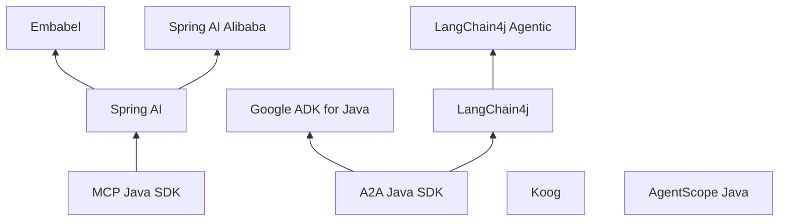

# Java Agent 开发

## 定义

在 JVM（Java / Kotlin）上构建 [[concepts/ai-agent|AI Agent]] 的技术栈。2026 年它从“调模型的客户端库”发展成完整的三层：底层是协议 SDK，中间是 LLM 应用框架，上层是负责规划、编排和长时会话的 Agent 框架。主要项目大多在 2026 年进入 1.0 / 2.0 稳定版。

## 关键特征

- **协议 SDK 层**
  - [[entities/mcp-java-sdk|MCP Java SDK]]：工具与上下文接入，Spring 传输和注解放在 Spring AI 里
  - [[entities/a2a-java-sdk|A2A Java SDK]]：Agent 之间通信，见 [[concepts/agent2agent-protocol|A2A]]
- **LLM 应用框架层**
  - [[entities/spring-ai|Spring AI]]：ChatClient + Advisor 链，2.0 起工具循环也是 Advisor
  - [[entities/langchain4j|LangChain4j]]：声明式 AI Service，Quarkus 与 Spring Boot 都能用
- **Agent 框架层**
  - [[entities/embabel|Embabel]]：在 Spring AI 之上，用 [[concepts/goal-oriented-action-planning|GOAP]] 规划
  - LangChain4j Agentic：接口式 Agent + 工作流 / supervisor 模式（仍 beta）
  - [[entities/google-adk|Google ADK for Java]]：App + Plugin、事件压缩、人工审批、原生 A2A
  - [[entities/koog|Koog]]：JetBrains，Kotlin Multiplatform，1 年 API 稳定承诺
  - [[entities/agentscope|AgentScope Java]]：HarnessAgent + 托管 Service
  - [[entities/spring-ai-alibaba|Spring AI Alibaba]]：Agent Framework / Graph / Spring AI 三层
  - 计划中：Spring AI Agents（Spring Projects Experimental，原定 2026-11，2027 年中并入 Spring AI 3.0）
- **共同趋势**：上下文压缩、人工审批（suspend / resume）、持久会话与检查点、OpenTelemetry 观测、Agent Skills，与 Python / TypeScript 生态的 [[concepts/agent-harness|Agent Harness]] 思路一致

## 应用

选型参考（整理者归纳，非官方结论；版本截至 2026-11-04）：

| 场景 | 首选 | 备注 |
|---|---|---|
| Spring Boot 4，要稳定 API | Spring AI 2.0 | 需要规划能力时叠加 Embabel |
| 仍在 Spring Boot 3.5 | Spring AI 1.1.x 或 LangChain4j | Spring AI 1.1 的 MCP SDK 停在 0.18.x |
| Quarkus / 云原生、声明式接口 | LangChain4j + quarkus-langchain4j | agentic 模块仍是 beta |
| Google Cloud / Gemini / Vertex AI | Google ADK for Java | Python 版功能领先 |
| Kotlin 优先、多平台或移动端 | Koog | 1.0 起承诺 1 年 API 稳定 |
| 阿里云 / 通义 / Nacos | Spring AI Alibaba 或 AgentScope Java | 两者已互相集成 |
| 跨语言 Agent 互通 | A2A Java SDK | 工具接入统一走 MCP |

## 生态位置

- **层级**：[[maps/L4-开发工具与Agent|L4-开发工具与Agent]]
- 对应 TypeScript 生态的 [[entities/mastra|Mastra]]、[[entities/vercel-ai-sdk|AI SDK]]，Python 生态的 [[entities/langchain|LangChain]] / [[entities/langgraph|LangGraph]]

## 相关概念

- [[concepts/ai-agent|AI Agent]]
- [[concepts/agent-harness|Agent Harness]]
- [[concepts/model-context-protocol|Model Context Protocol（MCP）]]
- [[concepts/agent2agent-protocol|Agent2Agent 协议（A2A）]]
- [[concepts/goal-oriented-action-planning|目标导向行动规划（GOAP）]]

## 相关实体

- [[entities/spring-ai|Spring AI]]
- [[entities/langchain4j|LangChain4j]]
- [[entities/embabel|Embabel]]
- [[entities/google-adk|Google ADK]]
- [[entities/koog|Koog]]
- [[entities/agentscope|AgentScope]]
- [[entities/spring-ai-alibaba|Spring AI Alibaba]]
- [[entities/mcp-java-sdk|MCP Java SDK]]
- [[entities/a2a-java-sdk|A2A Java SDK]]

## 我的判断

<!-- 你的观点写在这里，和上面的事实分开 -->

## 来源摘录

- "Spring AI exists at the level of the Servlet API, while Embabel is more like Spring MVC." — [[sources/java-agent-ecosystem-survey-2026-11|Java Agent 开发生态调研]]
- "Despite the name, LangChain4j is not a Java port of LangChain (Python) — it is built for Java, not ported to it." — [[sources/java-agent-ecosystem-survey-2026-11|Java Agent 开发生态调研]]
