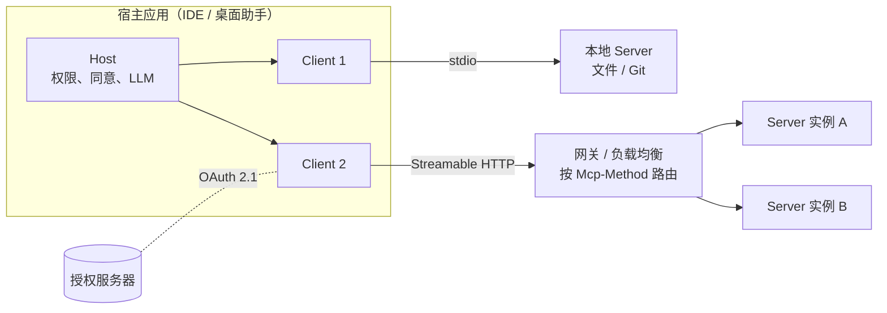
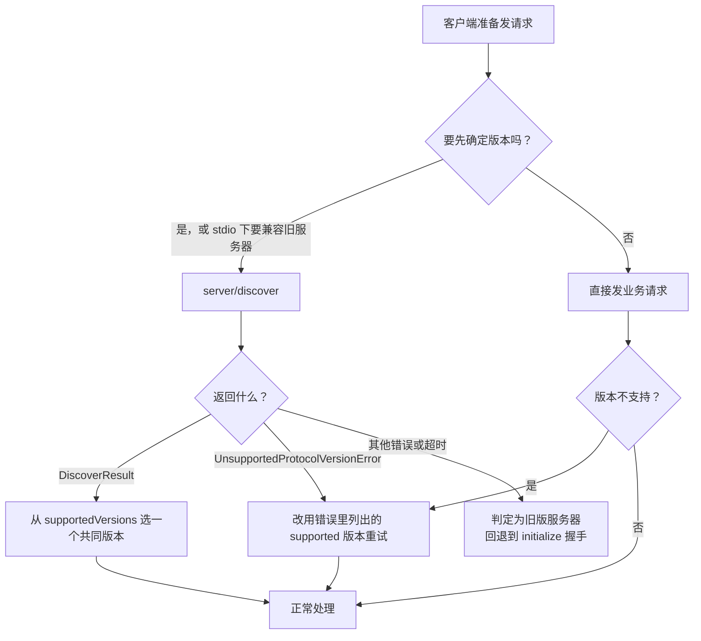
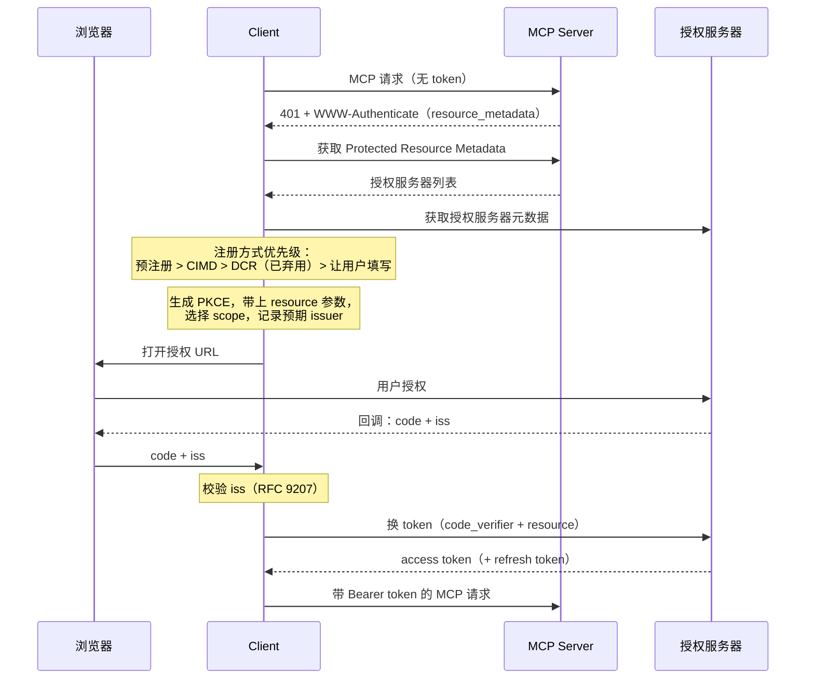
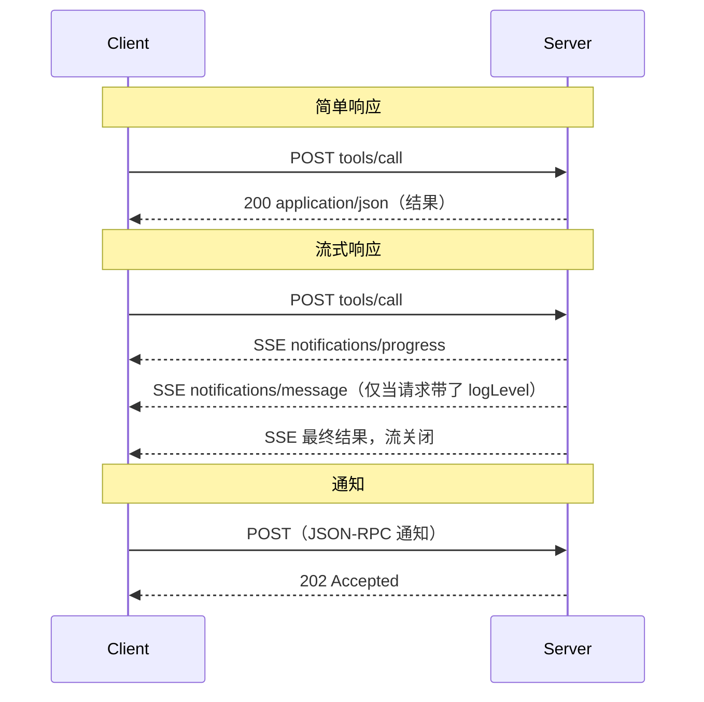
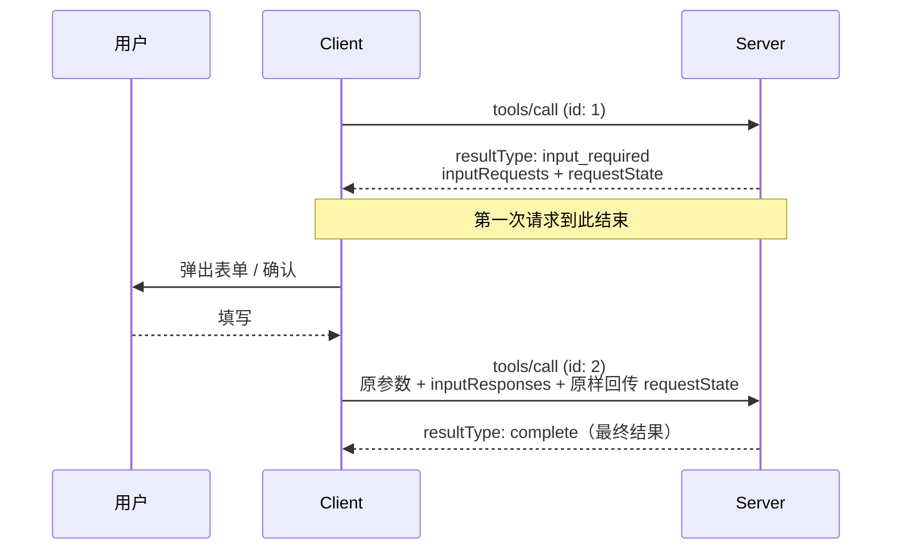
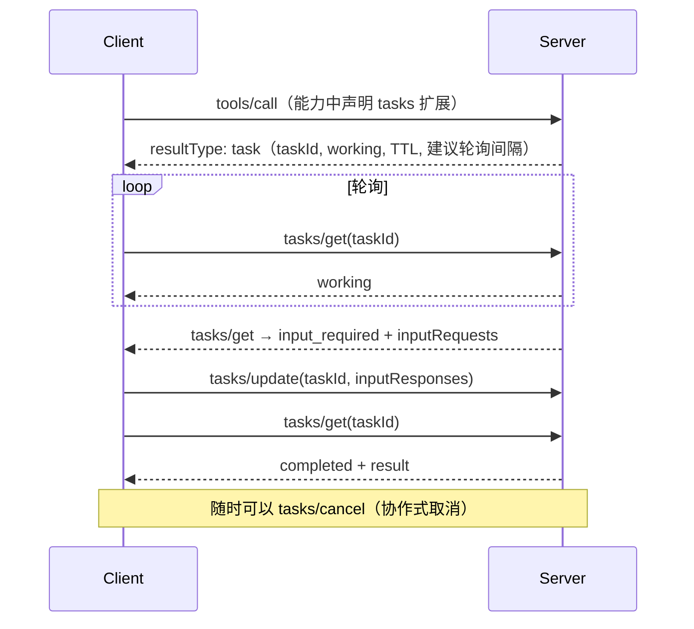
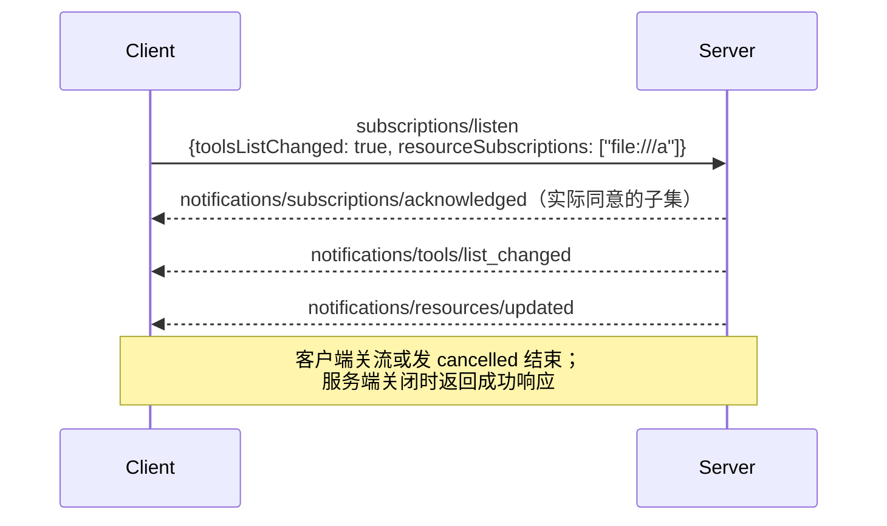

# MCP 请求流程（2026-07-28）

## 定义

[[concepts/model-context-protocol|MCP]] 2026-07-28 版规定的端到端交互流程。最大的变化是**没有了“连接—握手—会话”**：任何一个请求都可以单独发给任何一台服务器实例，服务器只看这个请求本身就能处理。下面按一次完整交互的顺序拆成 7 个阶段。

## 关键特征

- 每个请求在 `_meta` 中自带**版本、能力、身份**
- 服务端**从不主动发请求**：需要输入时返回 `input_required`，由客户端重试（MRTR）
- 推送通知只有一个入口：`subscriptions/listen`
- 所有结果必带 `resultType`
- HTTP 层面每条消息都是独立的 POST，没有 GET、DELETE 和会话头

## 全景



无状态的意义在于：实例 A 和 B 之间不需要共享会话存储，也不需要“粘性会话”式的负载均衡。

---

## 阶段 0：请求长什么样

每个请求都必须携带 `_meta` 元数据；走 HTTP 时还要把关键字段复制到请求头，供网关路由。

```http
POST /mcp HTTP/1.1
Content-Type: application/json
Accept: application/json, text/event-stream
MCP-Protocol-Version: 2026-07-28
Mcp-Method: tools/call
Mcp-Name: get_weather
Authorization: Bearer <access-token>

{
  "jsonrpc": "2.0",
  "id": 7,
  "method": "tools/call",
  "params": {
    "name": "get_weather",
    "arguments": { "city": "Hangzhou" },
    "_meta": {
      "io.modelcontextprotocol/protocolVersion": "2026-07-28",
      "io.modelcontextprotocol/clientCapabilities": { "elicitation": {} },
      "io.modelcontextprotocol/clientInfo": { "name": "MyClient", "version": "1.0.0" },
      "io.modelcontextprotocol/logLevel": "info",
      "traceparent": "00-…-…-01"
    }
  }
}
```

| 字段 / 头 | 作用 | 要求 |
|---|---|---|
| `_meta…/protocolVersion` | 本请求使用的协议版本 | 必须 |
| `_meta…/clientCapabilities` | 本请求声明的客户端能力（如 elicitation、扩展） | 必须 |
| `_meta…/clientInfo` | 客户端身份 | 应当 |
| `_meta…/logLevel` | 要日志才带；不带则服务端不得发 `notifications/message` | 可选 |
| `traceparent` 等 | OpenTelemetry 链路追踪 | 可选 |
| `MCP-Protocol-Version` 头 | 必须和 `_meta` 里的值一致，否则 400 + HeaderMismatch | HTTP 必须 |
| `Mcp-Method` / `Mcp-Name` 头 | 方法名，以及工具名、提示名或资源 URI | HTTP 必须 |
| `Mcp-Param-{Name}` 头 | 工具参数在 schema 里用 `x-mcp-header` 标注后镜像到头部 | 按需 |

服务端在每个结果的 `_meta` 中返回 `io.modelcontextprotocol/serverInfo`。

---

## 阶段 1：发现与版本协商

`server/discover` 是服务端**必须实现**、客户端**可以不调**的 RPC：一次返回支持的版本、能力、身份和说明（`instructions`），结果本身也可以缓存。



- 客户端和服务端**可以同时支持多个版本**，服务端按请求逐个接受或拒绝
- HTTP 下，旧版服务器的识别方式是：返回 400 且响应体不是可识别的新版错误，就回退到 `initialize`。不能只凭某个错误码判断
- 只支持新版的客户端不需要探测，但仍**推荐**探测：有些旧服务器会把 `tools/call` 按旧语义处理

---

## 阶段 2：授权（仅 HTTP 远程服务器）

MCP 服务器是 OAuth 2.1 的**资源服务器**。客户端第一次请求时没有 token，从 401 开始走发现流程：



本版本的授权变化：

- **CIMD 优先**：Client ID Metadata Documents 用一个 HTTPS URL 作为 `client_id`，取代动态客户端注册（DCR 已弃用）
- **`iss` 校验**：响应里带了 `iss`，客户端就必须校验
- **凭证绑定颁发者**：按 issuer 存储凭证，换了授权服务器就要重新注册
- **DCR 时声明 `application_type`**
- 运行时 scope 不够时，服务端返回 `insufficient_scope`，客户端走**增量授权**（step-up）

机器对机器认证和企业统一管控见扩展 `ext-auth`，参见 [[concepts/mcp-extensions|MCP 扩展]]。

---

## 阶段 3：列出能力与缓存

`tools/list`、`prompts/list`、`resources/list`、`resources/templates/list`、`resources/read` 的结果都实现了 `CacheableResult`：

```json
{
  "resultType": "complete",
  "tools": [ { "name": "get_weather", "inputSchema": { "type": "object" } } ],
  "ttlMs": 300000,
  "cacheScope": "private"
}
```

- `ttlMs`：新鲜度提示，在有效期内客户端可以不重新拉取
- `cacheScope`：`public` 表示共享中间层（网关、CDN）可以缓存，`private` 表示只能由客户端自己缓存
- 列表结果**不再因连接而不同**；`tools/list` 应按**确定顺序**返回，便于提高 LLM 提示缓存的命中率
- `inputSchema` / `outputSchema` 支持完整的 JSON Schema 2020-12

---

## 阶段 4：调用（tools/call 等）

服务端对每个请求自行决定：返回单个 JSON，或者返回一条**只属于这个请求**的 SSE 流。



- 进度和日志这类**与请求相关**的通知，只走该请求自己的响应流
- 服务端**不得**在这条流上发起 JSON-RPC 请求
- **取消**：HTTP 下关闭 SSE 流即表示取消；stdio 下发送 `notifications/cancelled`
- **断流**：没有续传；客户端必须用**新的请求 ID** 重发
- 需要跨调用保持状态（如购物车、浏览器会话）时，由服务端签发**显式句柄**，作为普通工具参数来回传递

---

## 阶段 5：需要客户端输入（MRTR）

服务端处理到一半，需要用户确认、调用 LLM，或者需要知道工作目录时，**不再主动发请求**，而是结束本次请求并把需要的输入列出来，由客户端补齐后重试。详见 [[concepts/multi-round-trip-requests|多轮往返请求（MRTR）]]。



仅 `tools/call`、`prompts/get`、`resources/read` 这三类请求可以返回 `input_required`。

---

## 阶段 6：长任务（Tasks 扩展）

耗时几分钟以上的操作（CI、批处理、人工审批）可以返回**任务句柄**，客户端轮询。前提是双方都在能力里声明了扩展 `io.modelcontextprotocol/tasks`。



任务状态：`working` → `input_required` → `completed` / `failed` / `cancelled`。断线重连后可以用同一个 `taskId` 继续轮询。

---

## 阶段 7：订阅变更通知

想在工具列表或资源变化时收到推送，就开一条长连接的 `subscriptions/listen`（HTTP 下是一个保持打开的 POST 响应流）：



- 可订阅的类型：`toolsListChanged`、`promptsListChanged`、`resourcesListChanged`、`resourceSubscriptions`（资源 URI 列表）
- 服务端**不得**发送客户端没订阅的类型；确认消息必须是这条流上的第一条
- 每条通知都在 `_meta` 中带 `io.modelcontextprotocol/subscriptionId`（取值为 listen 请求的 JSON-RPC id），用来区分同时存在的多个订阅

---

## 新旧对照（2025-11-25 → 2026-07-28）

| 环节 | 2025-11-25 及以前 | 2026-07-28 |
|---|---|---|
| 建立连接 | `initialize` → `initialized` 握手 | 无握手；可选调用 `server/discover` |
| 版本 / 能力 | 握手时协商一次 | 每个请求的 `_meta` 都带 |
| 会话 | `Mcp-Session-Id`，用 DELETE 结束 | 无；需要状态时用显式句柄 |
| 服务端发起的请求 | sampling / elicitation / roots 作为独立请求 | MRTR：`input_required` 加重试 |
| 推送通道 | HTTP GET 独立 SSE 流，`resources/subscribe` | `subscriptions/listen` |
| 断线 | `Last-Event-ID` 续传 | 不续传，用新 ID 重发 |
| 心跳 / 日志 | `ping`、`logging/setLevel` | 去掉；日志级别按请求设置 |
| 长任务 | 核心内的实验性 Tasks（`tasks/result` 阻塞） | 扩展 `tasks`，`tasks/get` 轮询，`tasks/update` 补充输入 |
| 结果类型 | 隐式 | 必带 `resultType`（缺省按 `complete` 处理） |
| 网关路由 | 需要解析请求体 | `Mcp-Method` / `Mcp-Name` 头 |
| 缓存 | 无标准 | `ttlMs` + `cacheScope` |
| 客户端注册 | DCR 或 CIMD | 优先 CIMD，DCR 已弃用 |

## 错误码速查

| 码 | 含义 |
|---|---|
| `-32601` | 方法不存在（HTTP 404） |
| `-32602` | 参数无效；**资源不存在**也改用此码（原为 `-32002`） |
| `-32020` | HeaderMismatch：请求头和请求体不一致 |
| `-32021` | MissingRequiredClientCapability：缺少必需的客户端能力 |
| `-32022` | UnsupportedProtocolVersion：版本不支持，错误里附带 `supported` 列表 |
| `-32000`～`-32019` | 由实现自定义 |
| `-32020`～`-32099` | 保留给 MCP 规范 |

## 已弃用（至少保留 12 个月）

| 特性 | 迁移方式 |
|---|---|
| Roots | 改用工具参数、资源 URI 或服务器配置传目录 |
| Sampling | 服务端直接对接 LLM 提供商的 API |
| Logging | stdio 下写 `stderr`，或使用 OpenTelemetry |
| HTTP+SSE 传输（2024-11-05） | 迁移到 Streamable HTTP |
| `includeContext: thisServer / allServers` | 省略该字段或用 `none` |
| 动态客户端注册（DCR） | 改用 CIMD |

## 应用

- **写 MCP 服务器**：实现 `server/discover`；每个结果带 `resultType` 和 `serverInfo`；列表结果带 `ttlMs` / `cacheScope`；不再依赖会话；`requestState` 要做完整性保护
- **写 MCP 客户端**：每个请求带 `_meta` 并镜像到请求头；处理 `input_required` 并重试；断流后重发；需要兼容旧服务器时先探测
- **部署**：可以放在普通的无状态负载均衡或 API 网关后面，按 `Mcp-Method` 做路由、限流和审计

## 生态位置

- **层级**：[[maps/L4-开发工具与Agent|L4-开发工具与Agent]]

## 相关概念

- [[concepts/model-context-protocol|Model Context Protocol（MCP）]]
- [[concepts/multi-round-trip-requests|多轮往返请求（MRTR）]]
- [[concepts/mcp-extensions|MCP 扩展]]
- [[concepts/ai-agent|AI Agent]]

## 相关实体

- [[entities/anthropic|Anthropic]]
- [[entities/claude-code|Claude Code]]

## 我的判断

## 来源摘录

- "Servers **MUST** send server-to-client requests (such as `roots/list`, `sampling/createMessage`, or `elicitation/create`) using the MRTR pattern." — [[sources/mcp-spec-2026-07-28|MCP 规范 2026-07-28]]
