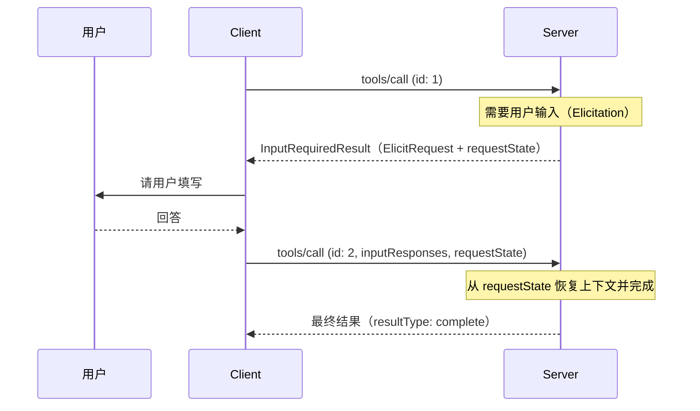

# 多轮往返请求（MRTR）

## 定义

[[concepts/model-context-protocol|MCP]] 2026-07-28 版引入的交互模式（SEP-2322），取代服务端主动向客户端发请求的旧做法。服务端需要额外信息时，返回 `resultType: "input_required"` 的 `InputRequiredResult`，结束本次请求；客户端收集信息后，带上 `inputResponses` **重试原请求**。两次请求相互独立，所以服务端不需要保存会话，也不需要粘性负载均衡。

## 关键特征

- **适用范围**：只有 `tools/call`、`prompts/get`、`resources/read` 可以返回 `input_required`
- **`inputRequests`**：一个映射，键由服务端指定，值是 `elicitation/create`、`sampling/createMessage` 或 `roots/list` 请求；只能放客户端在能力里声明过的类型
- **`inputResponses`**：客户端按相同的键给出结果，在重试时附上
- **`requestState`**：服务端自己编码的不透明字符串，客户端必须**原样回传**，不得解析或修改
- 每个 `InputRequiredResult` 至少包含 `inputRequests` 和 `requestState` 中的一个
- 重试必须使用**新的 JSON-RPC id**
- 服务端可以多次返回 `input_required`，直到信息足够；缺少信息时应再次索取，而不是报错

## 安全要点

- `requestState` 要视为**攻击者可控的输入**。只要它影响授权、资源访问或业务逻辑，就必须做完整性保护（HMAC 或 AEAD），校验失败就拒绝
- 防重放：在受保护的载荷里放入**认证主体**、**较短的过期时间**、**原请求标识**（方法名加关键参数摘要），收到时逐项校验
- 上述措施不能保证只用一次；一次性操作（如兑换）要在服务端单独保证

## 流程

## 应用

- 工具执行前请用户确认或补充参数（Elicitation 表单模式或 URL 模式）
- 外部 OAuth 等带外交互：客户端通过重试得知结果，原来的 `notifications/elicitation/complete` 已去掉
- 无状态部署：任何实例都能处理重试请求

## 生态位置

- **层级**：[[maps/L4-开发工具与Agent|L4-开发工具与Agent]]

## 相关概念

- [[concepts/mcp-request-flow|MCP 请求流程（2026-07-28）]]
- [[concepts/model-context-protocol|Model Context Protocol（MCP）]]
- [[concepts/mcp-extensions|MCP 扩展]]

## 相关实体

- [[entities/anthropic|Anthropic]]

## 我的判断

## 来源摘录

- "the server processing the retry does not need any information beyond what is directly present in the retry request." — [[sources/mcp-spec-2026-07-28|MCP 规范 2026-07-28]]
