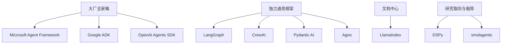

# Python Agent 开发

## 定义

用 Python 构建 [[concepts/ai-agent|AI Agent]] 的技术栈。Python 是 Agent 框架最密集的语言，大厂 SDK 通常先出 Python 版（[[entities/google-adk|Google ADK]]、[[entities/openai-agents-sdk|OpenAI Agents SDK]] 都是 Python 版领先）。2025 下半年到 2026 年，主要框架纷纷进入 1.0 或更高的大版本。

## 关键特征

- **大厂全家桶**：与自家云平台深度集成
  - [[entities/microsoft-agent-framework|Microsoft Agent Framework]]：合并 Semantic Kernel 与 AutoGen，.NET 与 Python 同步，1.0 于 2026-04
  - [[entities/google-adk|Google ADK]]：Python 2.0（2026-05）改为图式 Workflow Runtime
  - [[entities/openai-agents-sdk|OpenAI Agents SDK]]：轻量原语（Agent、Handoff、Guardrail），仍在 0.x
- **独立通用框架**
  - [[entities/langgraph|LangGraph]]：显式状态图、检查点、人工介入
  - [[entities/crewai|CrewAI]]：Crews（角色化自主协作）+ Flows（事件驱动控制）
  - [[entities/pydantic-ai|Pydantic AI]]：类型安全，V2 以 capability 为组合单元
  - [[entities/agno|Agno]]：扩展为自带 API、鉴权、调度的 Agent 服务平台 AgentOS
- **文档中心**：[[entities/llamaindex|LlamaIndex]]，从 RAG 框架转向 LlamaParse 文档平台，Agent Workflows 独立成 LlamaAgents
- **研究取向与极简**
  - [[entities/dspy|DSPy]]：把提示当成可优化的程序，用 GEPA 等优化器自动调优
  - [[entities/smolagents|smolagents]]：CodeAgent 用代码表达动作，2026-05 后更新放缓

2026 年的两个共同趋势：

1. **图式 / 事件驱动工作流成为标配**：MAF 的 graph workflow、CrewAI Flows、LlamaIndex Agent Workflows、ADK 2.0 Workflow Runtime 和 LangGraph，都是“确定性编排 + Agent 节点”的组合
2. **Harness 化**：在核心 Agent 循环之外提供文件、shell、记忆、沙箱、上下文压缩等能力，如 Pydantic AI Harness、MAF 的 Agent Harness（预览）、Agno AgentOS，见 [[concepts/agent-harness|Agent Harness]]

## 应用

选型参考（整理者归纳，非官方结论）：

- Azure / Foundry / .NET 混合团队，或手上有 Semantic Kernel、AutoGen 代码：[[entities/microsoft-agent-framework|Microsoft Agent Framework]]
- 需要显式状态图与检查点，不想绑定云：[[entities/langgraph|LangGraph]]
- 用“角色 + 任务”快速搭多 Agent 原型，或需要商业控制面：[[entities/crewai|CrewAI]]
- 重视类型安全和结构化输出：[[entities/pydantic-ai|Pydantic AI]]
- 以文档解析、抽取为核心：[[entities/llamaindex|LlamaIndex]]
- 有评测数据、想自动优化提示：[[entities/dspy|DSPy]]（可与其他框架组合）
- 研究、教学、开源模型与代码执行型 Agent：[[entities/smolagents|smolagents]]
- 想直接得到可部署的 Agent 服务平台：[[entities/agno|Agno]]
- 深度绑定 Gemini / Vertex AI 或 OpenAI：[[entities/google-adk|Google ADK]] 或 [[entities/openai-agents-sdk|OpenAI Agents SDK]]

## 生态位置

- **层级**：[[maps/L4-开发工具与Agent|L4-开发工具与Agent]]
- **对照**：[[concepts/java-agent-development|Java Agent 开发]]；TypeScript 侧见 [[entities/mastra|Mastra]]、[[entities/vercel-ai-sdk|AI SDK]]
- **协议**：[[concepts/model-context-protocol|MCP]] 接工具，[[concepts/agent2agent-protocol|A2A]] 做 Agent 间互通

## 相关概念

- [[concepts/ai-agent|AI Agent]]
- [[concepts/agent-harness|Agent Harness]]
- [[concepts/java-agent-development|Java Agent 开发]]
- [[concepts/rag|检索增强生成（RAG）]]
- [[concepts/model-context-protocol|Model Context Protocol（MCP）]]
- [[concepts/agent2agent-protocol|Agent2Agent 协议（A2A）]]

## 相关实体

- [[entities/microsoft-agent-framework|Microsoft Agent Framework]]
- [[entities/crewai|CrewAI]]
- [[entities/llamaindex|LlamaIndex]]
- [[entities/pydantic-ai|Pydantic AI]]
- [[entities/dspy|DSPy]]
- [[entities/smolagents|smolagents]]
- [[entities/agno|Agno]]
- [[entities/langgraph|LangGraph]]
- [[entities/google-adk|Google ADK]]
- [[entities/openai-agents-sdk|OpenAI Agents SDK]]

## 我的判断

<!-- 你的观点写在这里，和上面的事实分开 -->

## 来源摘录

- "Microsoft Agent Framework (MAF) is an open, multi-language framework for building **production-grade AI agents and multi-agent workflows** in **.NET and Python**." — [[sources/python-agent-frameworks-survey-2026-11|Python Agent 框架调研]]
- "It gives developers autonomous agent collaboration through Crews and precise, event-driven control through Flows." — [[sources/python-agent-frameworks-survey-2026-11|Python Agent 框架调研]]
