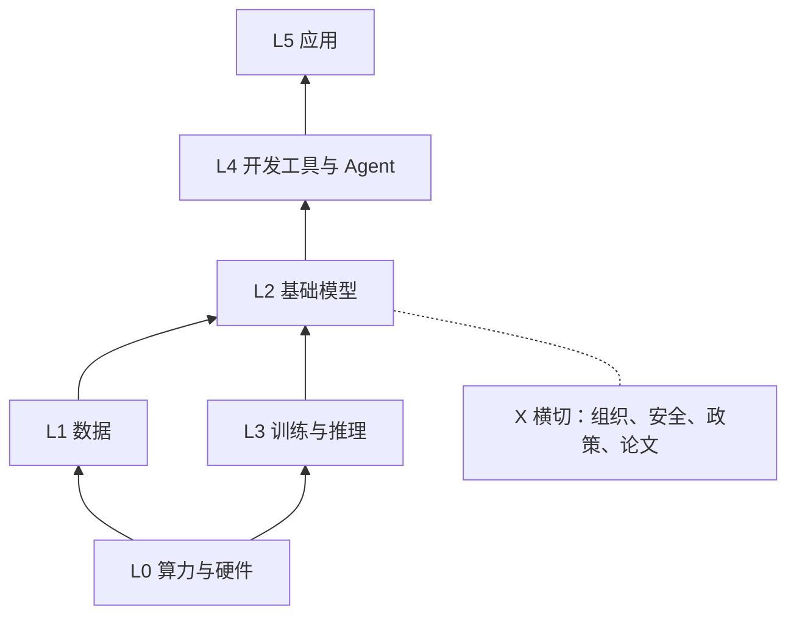

# AI 技术生态地图

从下到上按“依赖方向”分层：下层为上层提供能力。每个实体或概念用 `layer` 字段挂到一层，靠 `depends_on` / `competitors` 和正文链接连成网。

- [[maps/L0-算力与硬件|L0-算力与硬件]]：芯片、加速器、云与数据中心
- [[maps/L1-数据|L1-数据]]：数据集、合成数据、向量数据库、数据工程
- [[maps/L2-基础模型|L2-基础模型]]：LLM、多模态、图像/视频/语音模型；开源与闭源
- [[maps/L3-训练与推理|L3-训练与推理]]：训练框架、推理引擎、微调、量化、部署
- [[maps/L4-开发工具与Agent|L4-开发工具与Agent]]：SDK、Agent 框架、RAG、评测、可观测性、协议
- [[maps/L5-应用|L5-应用]]：编程助手、对话助手、搜索、办公、创意、垂直行业
- [[maps/X-横切主题|X-横切主题]]：组织与人物、安全对齐、政策法规、开源社区、关键论文

收录规则见 [[conventions|使用约定]]。完整页面目录见 [[index|Wiki Index]]（由插件自动生成）。



## 一条典型链路

[[entities/nvidia|NVIDIA]] → [[entities/cuda|CUDA]] → [[entities/pytorch|PyTorch]] → [[entities/llama|Llama]] → [[entities/vllm|vLLM]] → [[entities/langchain|LangChain]] / [[concepts/model-context-protocol|Model Context Protocol（MCP）]] → [[entities/cursor|Cursor]]

## 维护看板

```dataview
TABLE WITHOUT ID file.link AS 待核实条目, layer AS 层, updated AS 更新
FROM "wiki/entities" OR "wiki/concepts"
WHERE reviewed = false
SORT layer ASC
```

```dataview
TABLE WITHOUT ID file.link AS "超过 90 天未更新", updated AS "更新"
FROM "wiki/entities" OR "wiki/concepts"
WHERE date(today) - date(updated) > dur(90 days)
```

## 统计

```dataview
TABLE WITHOUT ID layer AS 层, length(rows) AS 条目数
FROM "wiki/entities" OR "wiki/concepts"
GROUP BY layer
SORT layer ASC
```
